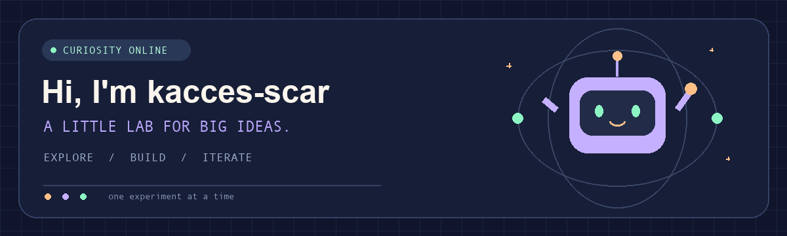

  

  <b>Stay curious. Turn ideas into things you can explore.</b> 
  Build something. Make it better. Share the journey.

  <a href="#-about-this-lab">About this lab</a> ·
  <a href="#-project-showcase">Project showcase</a> ·
  <a href="https://github.com/kacces-scar?tab=repositories">All repositories ↗</a>

---

### 🪐 About this lab

Hi, I'm **kacces-scar**. Welcome to my little lab.

This is where I keep engineering explorations, hands-on experiments, and the steps between an idea and its next iteration. I like sharing how things evolve, along with the final results.

🛠️ **Build it** — Give an idea a form you can explore and improve.  
🔬 **Try again** — Document the options, compare the results, and iterate.  
🌱 **Stay curious** — Learn by doing and share the process.

### 🚀 Project showcase

| Project | What's inside |
| :--- | :--- |
| **[📡 CST Iteration Archive](https://github.com/kacces-scar/cst-iteration-archive)** | An antenna design archive with CST project files, a file manifest, and the design journey from early concepts to final candidates. |

🔎 Open the lab notebook

 

The CST archive preserves multiple design stages for comparing geometry, port definitions, solver settings, and simulation results. See the project README for details and usage notes.

**My guiding principle: build it, improve it, and keep a record of what changed.**

---

  <b>Thanks for stopping by! 👋</b> 
  This little lab is still growing. See you at the next experiment.

